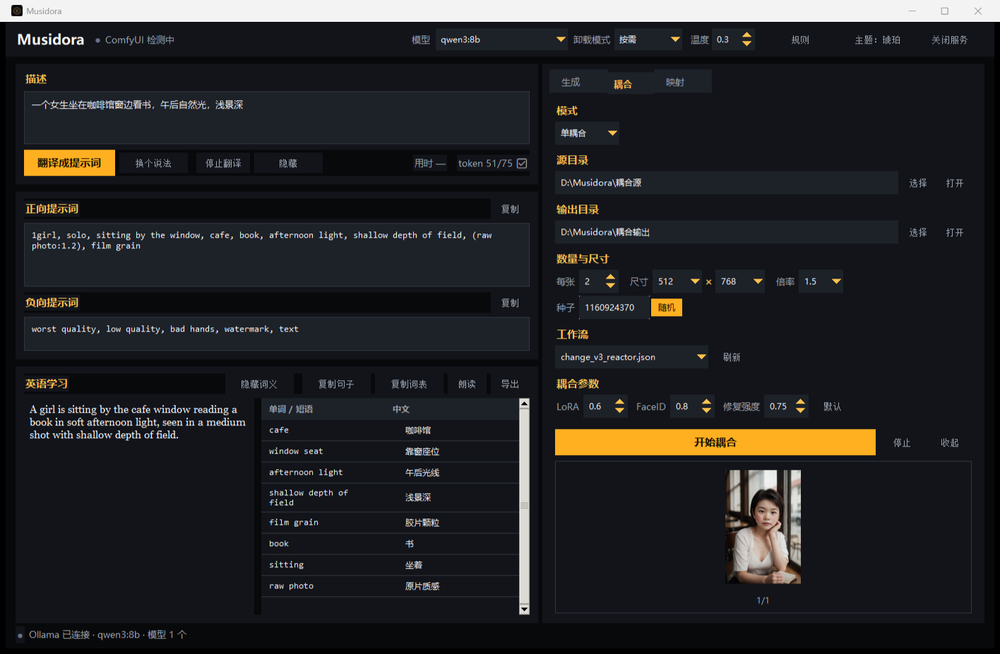
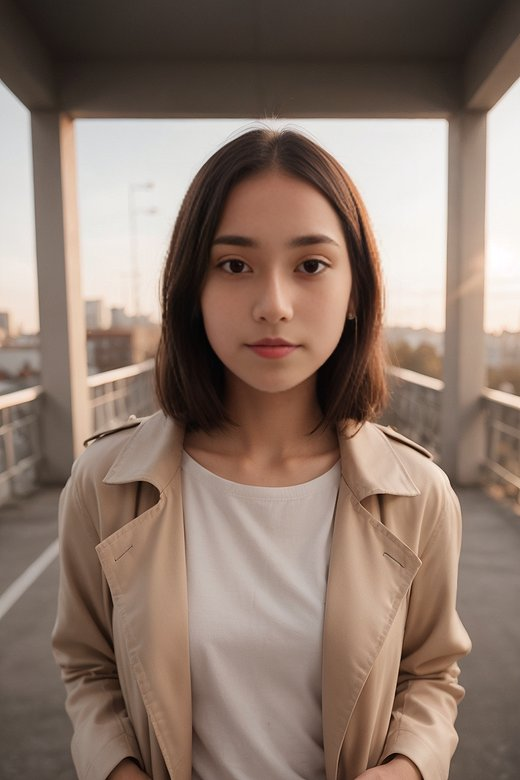

# Musidora

> 中文描述 → 英文提示词 → ComfyUI 出图 → 特征耦合 / 批量映射，一个窗口全做完。

一个 Windows 本地小工具，纯离线运行。把几件麻烦事收进一个界面：

- 中文翻成 SD 提示词（顺带产出英文句子和词表，可以拿来学英语）
- 参数、工作流、目录集中管理，不用在十几个 JSON 里翻
- 翻译模型和出图模型抢 8 GB 显存时自动调度，避免"谁被挤到 CPU 就慢十倍"
- 批量任务串行跑完，不用守着点

不想一步步配环境的话，可以把仓库交给 AI 助手（DSH、Cursor、Claude Code 等），让它照 `docs/SETUP.md` 和 `docs/LESSONS.md` 装好——路径、模型名、启动参数都写在仓库里。



## 三个功能

| 页签 | 做什么 |
|---|---|
| **生成** | 写中文 → 翻译出提示词/负向/英文句子/词表 → 单张或批量直出 |
| **耦合** | 参考图提供人物特征，提示词提供场景；单耦合固定 1 个主体，多耦合按源图人数自动判定，出图带相似度评分 |
| **映射** | 把母版人脸批量贴到一目录图片上（最弱，见「短板」） |

## 成图演示

**① 生成母版（512×768，半身正脸）**


**② 以母版为参考图，耦合到新场景（768×1152，相似度 0.89）**



**③ 批量映射：两个不同的人，换成母版的脸**

| 目标一（映射前） | 目标一（映射后，相似度 0.11 → 0.78） |
|---|---|
|  |  |

| 目标二（映射前） | 目标二（映射后，相似度 0.16 → 0.80） |
|---|---|
|  |  |

脸换过去了，但发型、脸型轮廓、衣服和光照都没变——这就是「贴图式」的证据。

## 优势

| 项 | 内容 |
|---|---|
| 参数已调好 | 512×768 ×1.5 = 768×1152，约 27 秒/张，单脸相似度 0.86~0.90，8 GB 显存的甜点 |
| 显存调度 | 按需 / 出图优先 / 翻译优先三种策略，实测能避免 27 秒变 90 秒 |
| 坑已固化 | 负数种子、缓存命中、半驻留模型、异步释放显存、线程读 Tk 变量……文档里都有修法 |
| 全本地 | 不联网、不要 API key、不上传图片 |

`提示词规则.txt` 是翻译用的系统提示词，可自行修改，改完立即生效。

## 快速开始

```bash
ollama pull qwen3:8b          # 翻译模型
pip install -r requirements.txt
python app.py                 # 或双击 启动.bat
```

ComfyUI 与自定义节点安装见 [docs/SETUP.md](docs/SETUP.md)。

## 文档

| 文档 | 内容 |
|---|---|
| [docs/SETUP.md](docs/SETUP.md) | 环境配置步骤 + 配置阶段的坑 + 检查清单 |
| [docs/LESSONS.md](docs/LESSONS.md) | 全部踩坑记录（速度/模型/出图/界面/测试） |
| [docs/USAGE.md](docs/USAGE.md) | 三个页签的用法与参数建议 |
| [docs/MODELS.md](docs/MODELS.md) | 模型清单、下载链接、国内加速、校验方法 |
| [docs/PIPELINE.md](docs/PIPELINE.md) | 三条"保持同一张脸"的技术路线对比 |
| [docs/TRAIN_LORA.md](docs/TRAIN_LORA.md) | 训练自己的脸部 LoRA |

## 短板：映射模块

映射本质是贴图式人脸替换，是全项目最弱的一环。

| 问题 | 表现 |
|---|---|
| 不重绘 | 脸是贴上去的，皮肤质感和光照方向与身体不匹配 |
| 只替换面部区域 | 头型、发型不变，角度差异大时一眼看出不是同一人 |
| 依赖正脸 | 侧脸超 45°、低头、逆光基本失效 |
| 小脸失效 | 脸小于 150 px 时糊成一团 |
| 参数不敏感 | 强度 0.3/0.5、GFPGAN/CodeFormer/不修复，清晰度与相似度差异都在 ±2 以内 |

实测（同一张图，只换修复模型）：

```
源图 117.2 清晰度 → GFPGAN 113.1（相似度 0.662）｜ CodeFormer 112.7（0.660）｜ 不修复 114.4（0.687）
```

需要质量请用耦合模块或专业工具；映射只适合批量、够用、不挑剔的场景。

## 已知限制

- 仅 Windows（依赖 `nvidia-smi`、Win32 进程控制、SAPI 朗读）
- 8 GB 显存上限：512×768 ×1.5 约 27 秒/张；1024×1536 会爆显存
- 翻译质量强依赖本地模型，8B 以下只建议简单描述
- 工作流依赖 ReActor 自定义节点

## 许可

- 代码 MIT；模型不随仓库分发
- `inswapper_128.onnx` 等 InsightFace 系模型为非商业研究用途，商用请自行取得授权
- 生成内容的合规责任由使用者承担
